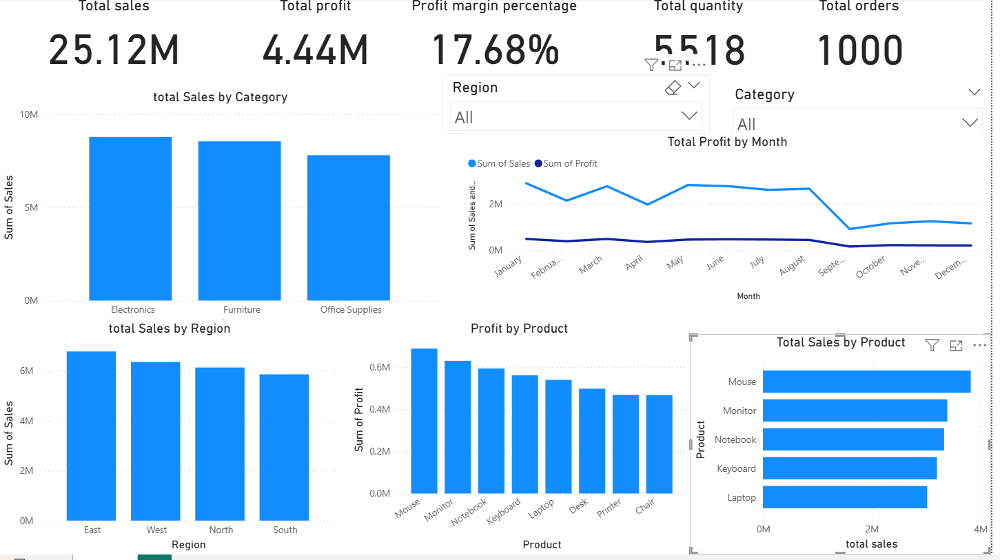

# Sales Performance Analysis Dashboard – Power BI

## 1. Project Description / Purpose
Developed an interactive sales dashboard using Power BI to analyze sales performance, profitability, product performance, and regional trends.

**Purpose:** To monitor key business metrics, identify sales trends, and understand which products and regions contribute to overall business performance.

## 2. Tech Stack
- **Power BI** – Dashboard development, data visualization, and KPI reporting.

## 3. Data Source
Sales dataset used for sales performance analysis.

## 4. Key Features & Highlights
- **Total Sales:** 25.12M
- **Total Profit:** 4.44M
- **Profit Margin:** 17.68%
- **Total Quantity:** 5,518
- **Total Orders:** 1,000
- Sales analysis by category and region.
- Profit analysis by product.
- Monthly sales and profit trends.

## 5. Project Outcome
Created an interactive dashboard to monitor sales performance, compare product and regional results, and support data-driven business decisions.

## Dashboard Preview

 
 ## Dashboard Preview

